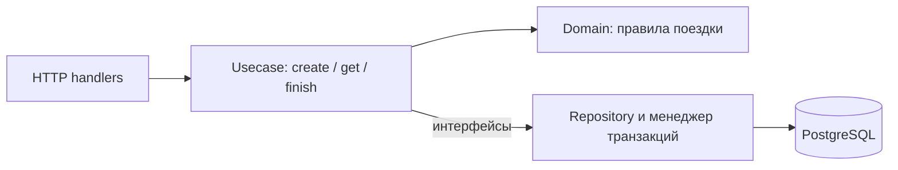

# TripGo Trip Service

HTTP-сервис поездок.

## Запуск

Нужны Go 1.26+, запущенный Docker и `tripgoctl`. Для проверки кода нужен `golangci-lint` v2. Команды выполняются из корня репозитория.

```bash
tripgoctl cluster start
tripgoctl environment start
tripgoctl connect
```

При первом запуске создайте `.env.local` с дополнительными настройками приложения. Остальные переменные создаёт `tripgoctl` в `.env`:

```dotenv
HTTP_READ_HEADER_TIMEOUT=5s
HTTP_READ_TIMEOUT=10s
HTTP_WRITE_TIMEOUT=15s
HTTP_IDLE_TIMEOUT=60s
IDEMPOTENCY_KEY_TTL=24h

OTEL_EXPORTER_OTLP_TIMEOUT=3000
OTEL_METRIC_EXPORT_INTERVAL=5000
```

После этого:

```bash
make migrate
make run
```

Makefile читает созданный `tripgoctl` файл `.env`, затем `.env.local`: локальные значения имеют приоритет. Адрес БД берётся из `.env`. Оба файла исключены из git; `.env.local` сохраняется при повторном запуске окружения. Полный пример конфигурации - `.env.example`.

Сервис слушает `HTTP_ADDR`, по умолчанию `:8080`.

Проверка:

```bash
curl -i localhost:8080/health
curl -i localhost:8080/ready
```

`/health` отвечает `200`, пока процесс жив. `/ready` отвечает `200`, если PostgreSQL доступен, и `503` иначе.

## Ручки

| Метод | Путь | Успех |
|---|---|---|
| `POST` | `/api/v1/trips` | `201`, повтор с тем же ключом и телом - `200` |
| `GET` | `/api/v1/trips/{tripId}` | `200` |
| `POST` | `/api/v1/trips/{tripId}/finish` | `200` |
| `GET` | `/health` | `200` |
| `GET` | `/ready` | `200` или `503` |

## Переменные окружения

Пример значений - `.env.example`. Обязательные настройки:

| Группа | Переменные |
|---|---|
| HTTP | `HTTP_ADDR`, `HTTP_READ_HEADER_TIMEOUT`, `HTTP_READ_TIMEOUT`, `HTTP_WRITE_TIMEOUT`, `HTTP_IDLE_TIMEOUT` |
| Приложение | `LOG_LEVEL`, `SHUTDOWN_TIMEOUT`, `IDEMPOTENCY_KEY_TTL` |
| PostgreSQL | `DATABASE_URL`, `DATABASE_MAX_CONNS`, `DATABASE_MIN_CONNS`, `DATABASE_MAX_CONN_LIFETIME`, `DATABASE_CONNECT_TIMEOUT`, `DATABASE_QUERY_TIMEOUT` |
| OpenTelemetry | `OTEL_SERVICE_NAME`, `OTEL_EXPORTER_OTLP_ENDPOINT`, `OTEL_EXPORTER_OTLP_PROTOCOL`, `OTEL_TRACES_SAMPLER` |

Дополнительно можно задать `OTEL_RESOURCE_ATTRIBUTES`, `OTEL_TRACES_SAMPLER_ARG` для ratio-сэмплера, `OTEL_EXPORTER_OTLP_TIMEOUT` и `OTEL_METRIC_EXPORT_INTERVAL`. Последние две настройки задаются в миллисекундах.

## Команды

| Команда | Что делает |
|---|---|
| `make migrate` | накатить миграции goose |
| `make run` | запустить сервис |
| `make test` | `go test -race -count=2 ./...` с отчётом покрытия |
| `make test-integration` | прогнать тесты с PostgreSQL, тегом `integration`, `-race` и `-count=2` |
| `make test-mutation` | прогнать мутационные тесты домена и usecase |
| `make lint` | `golangci-lint` |
| `make fmt` | отформатировать код |
| `make generate` | заново сгенерировать HTTP-типы, enum статуса и моки |

Интеграционные тесты по умолчанию поднимают PostgreSQL через Testcontainers. Вместо этого можно задать `TRIPGO_TEST_DATABASE_URL` существующей БД. Каждый сценарий создаёт и удаляет отдельную схему, поэтому пользователю БД нужны соответствующие права. Есть проверка отката поездки и истории при ошибке второго INSERT.

Последний unit-прогон: домен - 77,3%, usecase `create` - 93,6%, `get` и `finish` - 100%. Актуальное покрытие печатает `make test`.

## Архитектура

Диаграмма показывает вызовы. Usecase обращается к репозиторию через интерфейс и не импортирует его реализацию.



main читает конфигурацию, создаёт контейнер и управляет запуском и остановкой. internal/container собирает конкретные зависимости. HTTP разбирает запросы и формирует ответы, usecase выполняет сценарии, домен проверяет поля и переходы статусов. Репозитории выполняют SQL, infra содержит пул БД, транзакции и телеметрию.

У каждого действия свой пакет. Узкие неэкспортируемые интерфейсы объявлены в contract.go потребителя: HTTP объявляет интерфейс usecase, usecase - интерфейсы репозиториев и транзакций. Это позволяет подменять реализации и проверять сценарии с моками. Моки генерируются через `go:generate` в соседние mocks_test.go.

Домен не зависит от транспорта и инфраструктуры. Usecase не импортирует HTTP, сгенерированный API и реализации репозиториев. HTTP не импортирует репозитории и инфраструктуру. Эти границы проверяет depguard.

HTTP использует сгенерированные типы API. Между слоями передаются DTO из internal/model, а создание и завершение проверяет доменная модель. Координаты и статусы - общие доменные типы значений. Ошибки переводятся в HTTP-ответ в одном месте - domainerror.ToProblem. Детали внутренних ошибок остаются в логах.

## Решения

### Уровень изоляции

В `Do` транзакция открывается с `Read Committed`.

Для запрета второй активной поездки этого достаточно. Наш индекс сериализует две вставки сам. Вторая ждёт первую и после её коммита получает ошибку дубликата.

### Менеджер транзакций

`transaction.Manager.Do` открывает транзакцию, кладёт `pgx.Tx` в контекст и вызывает переданную функцию. Ошибка или паника приводят к `ROLLBACK`, паника после этого пробрасывается дальше. Вложенный `Do` использует ту же транзакцию.

У `BeginTx`, `Commit` и `Rollback` отдельные таймауты `DATABASE_QUERY_TIMEOUT`. Для отката сначала снимается отмена исходного контекста через `context.WithoutCancel`, затем устанавливается таймаут. Общего ограничения времени на весь `Do` нет; запросы репозиториев ограничены своими таймаутами.

### Одна активная поездка на водителя

В миграции `0001_init_trips.sql` есть уникальный индекс `trips_driver_id_active_idx` по `driver_id` с условием `status = 'active'`. Завершённых поездок у водителя может быть сколько угодно, а активная - одна.

### Идемпотентность

Ключ из заголовка Idempotency-Key хранится в таблице `idempotency_keys` `IDEMPOTENCY_KEY_TTL` времени. Вместе с ключом лежат SHA-256 от полей запроса и `trip_id` созданной поездки.

## Наблюдаемость

Трейсы и метрики идут по OTLP в collector. HTTP инструментирован через otelhttp, PostgreSQL - через otelpgx на уровне пула. Логи slog пишутся в stdout в JSON и содержат trace_id и span_id внутри спана. Порядок middleware: Recover -> Tracing -> Logging -> Metrics -> router.

Адреса Jaeger, Grafana и Prometheus выводит `tripgoctl connect`.

## Мутационное тестирование

`make test-mutation` запускает Gremlins 0.6.0 для домена и usecase. Сгенерированный enum исключён.

| Прогон | Всего | Поймано | Выжило | Не покрыто |
|---|---:|---:|---:|---:|
| До усиления тестов | 48 | 45 | 1 | 2 |
| После усиления тестов | 48 | 48 | 0 | 0 |

Выжившая мутация убирала нормализацию координат в `hash.go`: тесты не проверяли равенство хешей для `0` и `-0`. Две непокрытые мутации затрагивали форматирование ненулевых координат. Добавлены проверки `0` и `-0`, дробных координат и изменения каждого поля запроса. Прогон текущей версии после перехода на DTO подтвердил результат: все 48 мутаций пойманы.

## Образ

Сборка:

```bash
docker build -f deploy/Dockerfile -t trip-service:lab2 .
```

Для запуска образа адреса БД и коллектора должны быть доступны из контейнера. Если в `.env` указан `localhost`, для Docker Desktop переопределите хост на `host.docker.internal` при запуске контейнера, сохранив порты окружения.

```bash
docker run --rm -p 8080:8080 \
  --env-file .env \
  --env-file .env.local \
  -e HTTP_ADDR=:8080 \
  trip-service:lab2
```